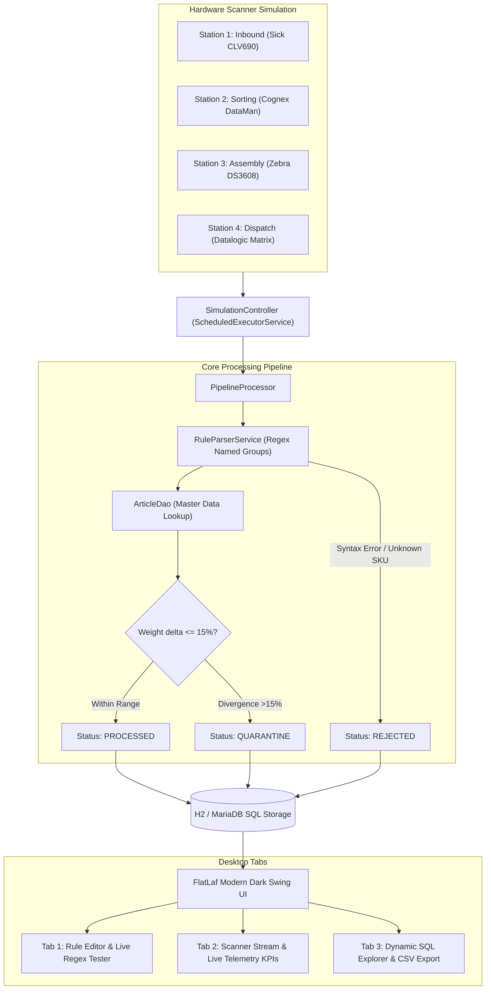

# 🏭 Industrial Hardware & SQL Pipeline Configurator

[](https://openjdk.org/)
[](https://maven.apache.org/)
[](https://www.formdev.com/flatlaf/)
[](https://h2database.com/)
[](https://github.com/brettwooldridge/HikariCP)
[](https://junit.org/junit5/)
[](LICENSE)

An enterprise-grade, multi-threaded **Desktop Application & Barcode Pipeline Configurator** engineered for high-throughput manufacturing, intralogistics, and automated conveyor systems. Built with **Java 17/21 LTS**, **Java Swing**, **FlatLaf (JetBrains-grade Dark Look & Feel)**, **HikariCP**, and **Embedded H2 SQL Database**.

---

## 🎯 The Industrial Challenge & Solution

### The Bottleneck in Manufacturing & Logistics
In automated factories and distribution centers (sorting lines, parcel belts, pallet high-bays), thousands of stationary hardware scanners (Sick, Zebra, Cognex) continuously stream telemetry and barcode data over RS-232, USB, and TCP/IP sockets.
- Conventional setups require code redeployments whenever barcode specifications or supplier labels change.
- Blocking I/O and unbuffered SQL writes cause packet drops and belt stoppages during peak throughput.
- Weight discrepancies (e.g. missing parts inside parcels) often go unnoticed until shipping.

### The Solution
This configurator provides an all-in-one desktop command center:
1. **Dynamic Regex Rule Editor:** Create, prioritize, and toggle barcode parsing rules on the fly with live named-group extraction (`sku`, `lot`, `weight`).
2. **Multi-Threaded Hardware Simulator:** Simulates 4 industrial scanner stations simultaneously via `ScheduledExecutorService`, processing up to 1,200 scans/minute with live KPI telemetry.
3. **Automated Quarantine & Anomaly Detection:** Validates physical package weights against master data ($\pm 15\%$ tolerance) and isolates bad parts (`QUARANTINE` / `REJECTED`) with clear audit reasons.
4. **Interactive SQL Database Explorer:** Directly browse and query local database tables (`scan_logs`, `routing_rules`, `articles`) with metadata introspection and 1-click CSV audit export.
5. **Robust Layered Architecture:** Model-DAO-Service-UI design with strict PreparedStatements, transactional connection pooling via HikariCP, and zero external runtime framework overhead.

---

## 🏗️ System Architecture



---

## 🖥️ UI Walkthrough (3 Specialized Tabs)

### 📐 Tab 1: Visual Rule Editor & Live Regex Tester
- **Rule Table:** View, edit, prioritize, and activate/deactivate hardware routing rules with instant checkbox toggles.
- **Rule Form:** Configure Name, Regex Pattern, Target Station, and Action (`INVENTORY_BOOKING`, `QUALITY_CHECK`, `DISPATCH`).
- **Live Regex Tester:** Real-time feedback pane that extracts `sku`, `lot`, and `weight` groups as you type, indicating match status with colored status badges.

### 🏭 Tab 2: Hardware Scanner Simulator & Real-Time Stream
- **4 Telemetry Metric Cards:** `Total Scans`, `Throughput (scans/min)`, `Quarantine Rate %`, and `Rejected / Faulty`.
- **Live Stream Table:** Color-coded `StatusBadgeCellRenderer`:
  - 🟢 **PROCESSED:** Successfully matched, verified, and routed.
  - 🟡 **QUARANTINE:** Flagged for inspection (e.g. weight divergence $> 15\%$).
  - 🔴 **REJECTED:** Unknown SKU or corrupt barcode syntax.
- **Manual Anomaly Injector:** 1-click injection of weight spikes, unknown SKUs, and sensor overflow payloads.
- **Frequency Slider:** Dynamically throttle scanner intervals between 50 ms and 1,500 ms.

### 💾 Tab 3: Dynamic SQL Database Explorer
- **Table Selector:** Quick navigation across `SCAN_LOGS`, `ROUTING_RULES`, and `ARTICLES`.
- **Interactive Query Console:** Write and execute any arbitrary SQL query with sub-millisecond execution timer.
- **Dynamic Table Grid:** Automatically constructs column headers and formats rows via `ResultSetMetaData`.
- **CSV Audit Export:** 1-click CSV file generator for warehouse auditing and reporting.

---

## 🚀 Quickstart & Execution

### Prerequisites
- Java 17 LTS or Java 21 LTS
- Apache Maven 3.8+

### 1. Build & Run Tests
```bash
git clone https://github.com/Tom7668h/java-pipeline-configurator.git
cd java-pipeline-configurator
mvn clean test
```
Runs the 14 automated unit and integration tests (RuleParserService, PipelineProcessor, RoutingRuleDao).

### 2. Package Executable Fat JAR
```bash
mvn package
```
Generates a standalone, shaded Fat JAR at `target/java-pipeline-configurator-1.0.0.jar` containing all libraries and native look & feel assets.

### 3. Launch the Application
```bash
java -jar target/java-pipeline-configurator-1.0.0.jar
```
*(Or run directly with Maven: `mvn exec:java -Dexec.mainClass="de.tom.configurator.App"`)*

---

## 📦 Database Schema & Sample Barcodes

### Tested Barcode Standards:
| Standard | Regex Pattern | Example Payload | Target Action |
| :--- | :--- | :--- | :--- |
| **GS1-128 Inbound** | `^01(?<sku>[0-9]{14})10(?<lot>[A-Z0-9]{6,10})310(?<weight>[0-9]{6})$` | `010401234510001810LOT8819A310000450` | `INVENTORY_BOOKING` |
| **Code-39 Assembly** | `^BC-(?<sku>[A-Z0-9]{8})-(?<lot>[0-9]{4})$` | `BC-KNORR901-2024` | `QUALITY_CHECK` |
| **Express Dispatch** | `^EXP-(?<sku>[A-Z]{3}-[0-9]{4})-W(?<weight>[0-9]{4})$` | `EXP-BOS-2041-W4200` | `DISPATCH` |

---

## 📄 License
MIT License. Created by [Tom7668h](https://github.com/Tom7668h).
