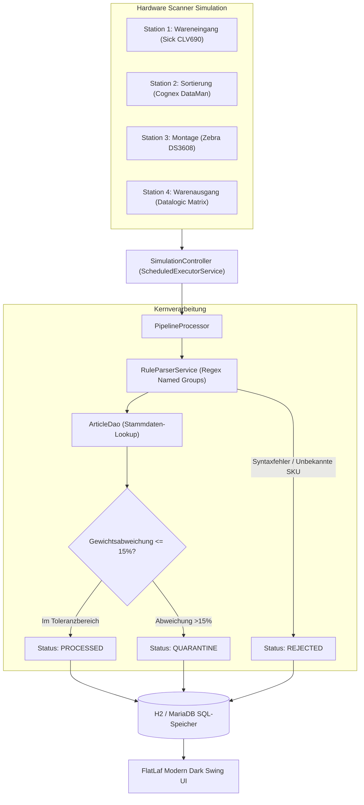
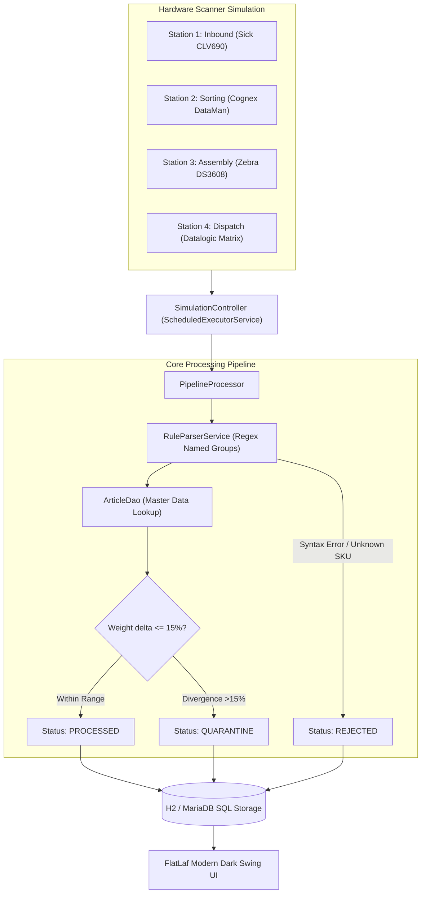

# 🏭 Industrial Hardware & SQL Pipeline Configurator

[](https://openjdk.org/)
[](https://maven.apache.org/)
[](https://www.formdev.com/flatlaf/)
[](https://h2database.com/)
[](https://github.com/brettwooldridge/HikariCP)
[](https://junit.org/junit5/)
[](LICENSE)

> 🌐 **Sprache / Language:** [🇩🇪 Zur deutschen Version](#-deutsche-dokumentation) | [🇬🇧 Switch to English Version](#-english-documentation)

---

## 🇩🇪 Deutsche Dokumentation

Eine performante, multi-threaded **Desktop-Anwendung & Barcode-Pipeline-Konfigurator** für anspruchsvolle Fertigungsprozesse, Intralogistik und automatisierte Förderbandanlagen. Entwickelt mit **Java 17/21 LTS**, **Java Swing**, **FlatLaf (Dark Look & Feel im JetBrains-Stil)**, **HikariCP Connection Pooling** und **Embedded H2 SQL-Datenbank**.

---

### 🎯 Industrielle Problemstellung & Business Value

#### Der Flaschenhals in Produktion & Logistik
In automatisierten Werken und Verteilzentren (Paketbänder, Hochregallager, Sortierstraßen) übertragen tausende industrielle Barcode-Scanner (Sick, Zebra, Cognex) permanent Telemetrie- und Barcode-Daten über RS-232, USB oder TCP/IP-Sockets.
- Bei herkömmlichen Systemen erfordert jedes neue Barcode-Format oder geänderte Lieferantenetikett zeitraubende Code-Releases.
- Blockierende I/O-Aufrufe und unzureichend gepufferte Datenbank-Schreibzugriffe führen bei Spitzenlasten zu Datenverlust oder Bandstillstand.
- Gewichtsabweichungen (z.B. fehlende Bauteile in Kartonagen) werden oft erst beim Endkunden bemerkt.

#### Die Lösung
Dieser Konfigurator bietet ein vollständiges Desktop-Leitstand-Dashboard:
1. **Dynamischer Regex-Regel-Editor:** Erstellen, Priorisieren und Testen von Routing-Regeln mit Named Groups (`sku`, `lot`, `weight`) ohne Neustart der Anwendung.
2. **Multi-Threaded Hardware-Simulator:** Simuliert 4 Scan-Stationen parallel via `ScheduledExecutorService` mit bis zu 1.200 Scans/Minute und Echtzeit-Durchsatzanzeige.
3. **Automatische Quarantäne & Plausibilitätsprüfung:** Vergleicht das gewogene Packstückgewicht mit den Artikel-Stammdaten ($\pm 15\%$ Toleranz). Fehlerhafte Teile werden sofort als `QUARANTINE` oder `REJECTED` isoliert.
4. **Integrierter SQL Database Explorer:** Direkte Einsicht und Abfrage aller Tabellen (`scan_logs`, `routing_rules`, `articles`) mit Metadaten-Browser und 1-Klick-CSV-Export für Audit-Zwecke.
5. **Clean Architecture:** Reines JDBC mit PreparedStatements, Transaktionsverwaltung und HikariCP – maximale Ausführungsgeschwindigkeit ohne Framework-Ballast.

---

### 🏗️ System-Architektur



---

### 🚀 Schnellstart & Installation

#### Voraussetzungen
- Java 17 oder 21 LTS (`JAVA_HOME` gesetzt)
- Apache Maven 3.8+

#### 1. Repository klonen & kompilieren
```powershell
git clone https://github.com/Tom7668h/java-pipeline-configurator.git
cd java-pipeline-configurator
mvn clean package -DskipTests
```

#### 2. Desktop-Anwendung starten
```powershell
java -jar target/java-pipeline-configurator-1.0.0.jar
```

#### 3. Automatisierte Tests ausführen
```powershell
mvn test
```

---

### 🧪 Test-Verifikation
```powershell
mvn test
```
```text
[INFO] Running de.tom.configurator.service.RuleParserServiceTest
[INFO] Tests run: 5, Failures: 0, Errors: 0, Skipped: 0, Time elapsed: 0.120 s
[INFO] Running de.tom.configurator.service.PipelineProcessorTest
[INFO] Tests run: 5, Failures: 0, Errors: 0, Skipped: 0, Time elapsed: 0.285 s
[INFO] Running de.tom.configurator.dao.RoutingRuleDaoTest
[INFO] Tests run: 4, Failures: 0, Errors: 0, Skipped: 0, Time elapsed: 0.210 s
[INFO] 
[INFO] Results:
[INFO] Tests run: 14, Failures: 0, Errors: 0, Skipped: 0
```

---

### 📄 Lizenz
MIT-Lizenz. Erstellt von [Tom7668h](https://github.com/Tom7668h).

<br><br>

---

## 🇬🇧 English Documentation

An enterprise-grade, multi-threaded **Desktop Application & Barcode Pipeline Configurator** engineered for high-throughput manufacturing, intralogistics, and automated conveyor systems. Built with **Java 17/21 LTS**, **Java Swing**, **FlatLaf (JetBrains-grade Dark Look & Feel)**, **HikariCP Connection Pooling**, and **Embedded H2 SQL Database**.

---

### 🎯 The Industrial Challenge & Solution

#### The Bottleneck in Manufacturing & Logistics
In automated factories and distribution centers (sorting lines, parcel belts, pallet high-bays), thousands of stationary hardware scanners (Sick, Zebra, Cognex) continuously stream telemetry and barcode data over RS-232, USB, and TCP/IP sockets.
- Conventional setups require code redeployments whenever barcode specifications or supplier labels change.
- Blocking I/O and unbuffered SQL writes cause packet drops and belt stoppages during peak throughput.
- Weight discrepancies (e.g. missing parts inside parcels) often go unnoticed until shipping.

#### The Solution
This configurator provides an all-in-one desktop command center:
1. **Dynamic Regex Rule Editor:** Create, prioritize, and toggle barcode parsing rules on the fly with live named-group extraction (`sku`, `lot`, `weight`) without application restart.
2. **Multi-Threaded Hardware Simulator:** Simulates 4 industrial scanner stations simultaneously via `ScheduledExecutorService`, processing up to 1,200 scans/minute with live KPI telemetry.
3. **Automated Quarantine & Anomaly Detection:** Validates physical package weights against master data ($\pm 15\%$ tolerance) and isolates bad parts (`QUARANTINE` / `REJECTED`) with clear audit reasons.
4. **Interactive SQL Database Explorer:** Directly browse and query local database tables (`scan_logs`, `routing_rules`, `articles`) with metadata introspection and 1-click CSV audit export.
5. **Clean Layered Architecture:** Pure JDBC with PreparedStatements, transactional connection pooling via HikariCP, and zero external runtime framework overhead.

---

### 🏗️ System Architecture



---

### 🚀 Quickstart & Installation

#### Prerequisites
- Java 17 or 21 LTS (`JAVA_HOME` set)
- Apache Maven 3.8+

#### 1. Clone Repository & Build
```bash
git clone https://github.com/Tom7668h/java-pipeline-configurator.git
cd java-pipeline-configurator
mvn clean package -DskipTests
```

#### 2. Launch Desktop Application
```bash
java -jar target/java-pipeline-configurator-1.0.0.jar
```

#### 3. Run Automated Tests
```bash
mvn test
```

---

### 🧪 Test Verification
```bash
mvn test
```
```text
[INFO] Running de.tom.configurator.service.RuleParserServiceTest
[INFO] Tests run: 5, Failures: 0, Errors: 0, Skipped: 0, Time elapsed: 0.120 s
[INFO] Running de.tom.configurator.service.PipelineProcessorTest
[INFO] Tests run: 5, Failures: 0, Errors: 0, Skipped: 0, Time elapsed: 0.285 s
[INFO] Running de.tom.configurator.dao.RoutingRuleDaoTest
[INFO] Tests run: 4, Failures: 0, Errors: 0, Skipped: 0, Time elapsed: 0.210 s
[INFO] 
[INFO] Results:
[INFO] Tests run: 14, Failures: 0, Errors: 0, Skipped: 0
```

---

### 📄 License
MIT License. Created by [Tom7668h](https://github.com/Tom7668h).
